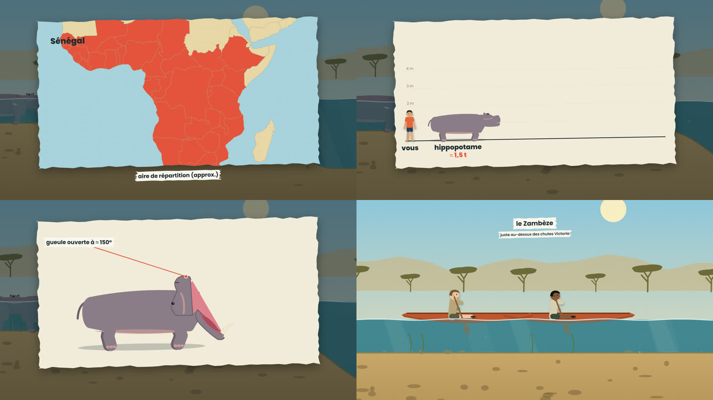
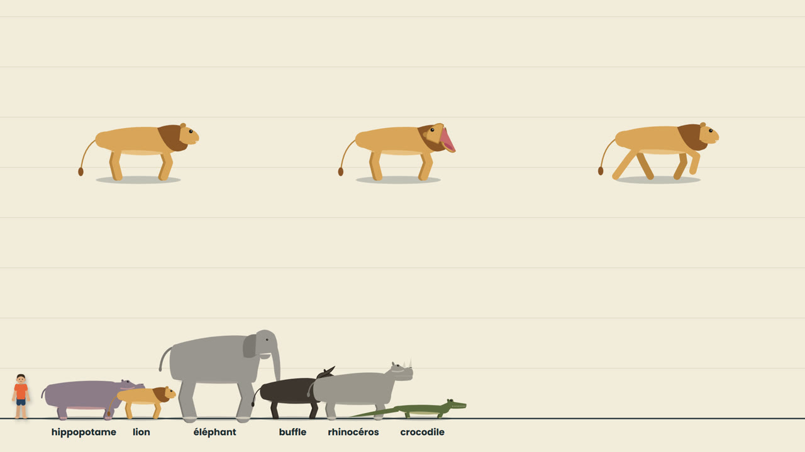

# Machine « Docu Papier 2D » pour Agent OS

Une usine à **documentaires animaliers en papier découpé**, dans le style des chaînes Oceanverse et Depth Theory : une accroche à la deuxième personne tirée d'une histoire vraie, cinq questions, des cartes animées (chiffres, cartes du monde, comparaisons de taille, anatomie, frises), un monde dessiné en plan-séquence où l'animal vit, et quelques plans réels sous licence libre.

**Tu donnes un animal et une durée. La machine rend la vidéo 1080p et tout ce qu'il faut pour la poster** : faits sourcés sur Wikipédia, script, voix off ElevenLabs, storyboard vérifié automatiquement, plans réels libres avec crédits, rendu Remotion, musique Suno mixée à −14 LUFS, **contrôle d'écoute** de la vidéo finale, puis titre, description (chapitres, sources des faits et des images), tags et miniature.



*Images rendues avec ce dépôt installé sur un Agent OS « starter » neuf, à partir du storyboard de l'exemple fourni (hippopotame, 9 min 56).*

---

## Ce que la machine fabrique

| Étape | Ce qui se passe |
|---|---|
| **1. Faits** | Pages Wikipédia FR + EN du sujet → registre de faits courts, chacun avec sa source. Un chiffre mal établi est marqué « incertain » et sera dit avec prudence. Le LLM cherche aussi une histoire vraie datée pour l'accroche et choisit l'animal du bestiaire qui le dessinera. |
| **2. Script** | Accroche « vous » (6-8 répliques), question-titre + sommaire, 5 chapitres « Question numéro N », CTA au milieu, fin en commentaire. La longueur est calculée sur le **débit mesuré** de la voix choisie (recalé à chaque run). Ton et rythme calqués sur l'exemple fourni. Puis une **relecture des faits** : chaque réplique est confrontée au registre, toute affirmation non sourcée est réécrite ou retirée. |
| **3. Voix** | ElevenLabs réplique par réplique, avec l'alignement mot à mot ; resserrage des silences, fins de phrase propres, pauses ajustées pour tomber sur la durée visée. Les répliques déjà générées sont en cache. |
| **4. Storyboard** | Le LLM n'écrit que des « beats » typés (carte, étiquette, scène du monde, plan réel) ancrés sur **un mot exact** de la voix. La mise en page est calculée. Le **vérificateur** (`remotion/scripts/d2-check.ts`) contrôle ancrages, durées de lecture, encombrement, longueur des textes et physique du monde image par image ; le storyboard est corrigé jusqu'à 0 anomalie. |
| **5. Plans réels** | Plans **libres de droits** : Pexels, Pixabay, Wikimedia Commons. Crédits enregistrés automatiquement. Images IA seulement si tu l'autorises, en dernier recours. La part de plans réels est **mesurée** et affichée. Une planche de relecture de 24 images est rendue. Chaque plan est **regardé par un modèle de vision** avant d'être gardé : bonne espèce exacte (un buffle d'eau asiatique n'est pas un buffle d'Afrique), vraie vidéo, scène conforme, pas en captivité — sinon candidat suivant. Sous la cible, la machine complète ; si un plan est introuvable (ex. une attaque de lion), il est retiré plutôt que remplacé par un plan trompeur. |
| **6. Rendu** | Remotion, composition `Docu2D` (entrée séparée `remotion/src/docu2d.tsx` : ton `Root.tsx` n'est pas touché). |
| **7. Mix** | Musique Suno enchaînée sur elle-même jusqu'à la fin, ducking sous la voix, −14 LUFS. Puis le **contrôle d'écoute** : début, milieu et fin de la vidéo finale sont transcrits (faster-whisper) et comparés au script. Une vidéo muette ou sans voix est refusée. |
| **8. Packaging** | Titre aux formules de la niche, description (accroche, chapitres horodatés, sources des faits, sources des images), tags, miniature. La vidéo va au Stock ; publication YouTube privée par défaut (si tu l'actives). |

En **Semi-manuel** (par défaut), la machine s'arrête deux fois pour que tu valides : après le script, puis après le storyboard et les plans (avec la planche de relecture). En **100 % auto**, elle va jusqu'au bout. Chaque étape se reprend là où elle s'est arrêtée, ou se relance depuis une étape choisie.

## Réglages

**À chaque vidéo** : le sujet (ou 💡 : 6 idées tirées des titres les plus vus de la niche), la famille (déduite du sujet), la durée (3 à 30 min, 10 par défaut), la langue (français, anglais, espagnol, allemand, portugais, italien), la voix ElevenLabs, la part de plans réels (0 à 40 %, 12 % par défaut), les sources (Pexels / Pixabay / Commons), les images IA de secours (non par défaut), la musique, le mode (Semi-manuel / 100 % auto), la publication automatique (chaîne + confidentialité).

**Voix** : George (voix publique ElevenLabs) par défaut ; la liste montre aussi les autres voix publiques, les voix de ton compte ElevenLabs et un champ pour coller n'importe quel ID de voix. « Ma voix clonée » utilise l'ID mis dans `Voix_Alex=` du fichier `.env` à la racine de ton Agent OS (le nom de la variable est historique ; mets-y l'ID de TA voix clonée).

**Paramètres** (onglet 🛠) : la marque écrite en fin de description, la durée et la part de plans réels par défaut, le volume et le style de la musique.

## Temps et coûts

Estimations de la machine elle-même (`POST /api/machines/docu2d/estimate`), avant que le débit de ta voix ne soit mesuré (165 mots/min par défaut) :

| Durée | Voix ElevenLabs | Musique Suno | Textes (OpenRouter) | **Total** | Rendu Remotion |
|---|---|---|---|---|---|
| 3 min | ~2 500 caractères, 0,37 $ | 0,06 $ | 0,08 $ | **≈ 0,51 $** | ≈ 15 min |
| 10 min | ~8 300 caractères, 1,24 $ | 0,06 $ | 0,08 $ | **≈ 1,38 $** | ≈ 45 min |
| 20 min | ~16 500 caractères, 2,48 $ | 0,06 $ | 0,08 $ | **≈ 2,62 $** | ≈ 1 h 30 |

- La voix est comptée au tarif public (0,15 $ / 1 000 caractères). **Si ton abonnement ElevenLabs couvre ces caractères, elle ne te coûte rien de plus** — vérifie juste ton quota mensuel : une vidéo de 10 min en consomme ~8 000.
- Plans réels : gratuits (Pexels, Pixabay, Commons). Images IA de secours (si activées) : ~0,02 $ l'image via Kie.
- Le temps est surtout celui du rendu Remotion : **mesuré ≈ 50 min pour la vidéo hippopotame de 10 min** (6 rendus en parallèle, sur le PC d'Alex occupé par d'autres tâches) — compte 4 à 5 min de rendu par minute de vidéo, moins sur une machine dédiée. Ajoute quelques minutes pour la voix, 1 à 4 passes de storyboard, la musique Suno (2 à 5 min) et le contrôle d'écoute. Au tout premier run, faster-whisper télécharge son modèle « small » (~500 Mo).

## Limites honnêtes de cette version (v1)

- **Qualité visuelle : en dessous des vidéos mises en scène à la main.** Le monde dessiné n'a encore qu'une dizaine de scènes génériques ; sur une espèce autre que l'hippopotame (pour qui elles ont été écrites), il se résume souvent à l'animal seul dans la plaine. Les contrôles empêchent les erreurs grossières (cartes vides, icônes fausses, animal dans la mauvaise scène, texte illisible) mais ne créent pas la richesse visuelle. Voir `docs/DISSECTION-DOCU2D-V1.md`. Relis toujours la planche à l'arrêt Semi-manuel.

- **Bestiaire : 6 animaux à quatre pattes** — hippopotame, lion, éléphant, buffle, rhinocéros, crocodile. Tu peux traiter un autre animal terrestre : le LLM choisit la silhouette la plus proche pour le dessin (les plans réels, eux, montrent le vrai animal).
- **Un seul monde : la savane** (plaine, berge, rivière avec troupeau). Les familles marin, insectes, oiseaux et phénomènes sont prévues pour les **phases suivantes** (grisées dans l'interface).
- **Zéro vidéo IA** (choix de la recette de la niche) et **pas de fair use** : uniquement des plans sous licence libre, crédités.
- La planche de relecture écrit l'horodatage avec la police `C:/Windows/Fonts/arial.ttf` : sur macOS / Linux elle échoue (le run continue, sans planche).
- Le contrôle d'écoute appelle la commande `python` : elle doit exister sous ce nom dans le PATH, avec `faster-whisper`.
- Le texte est écrit par Qwen via OpenRouter (avec repli automatique sur le Claude CLI connecté à Agent OS). Comme tout LLM, il peut se tromper : relis le script à l'arrêt Semi-manuel. Les faits sont limités à Wikipédia et sourcés dans la description.



---

## Installation

**Le plus simple : donne ce dépôt à ton assistant IA** (Claude Code, Codex, Cursor…) avec cette phrase :

> Installe la machine Docu Papier 2D dans mon Agent OS en suivant le fichier INSTALL-LLM.md de ce dépôt : https://github.com/Alex-sia99/docu2d-machine

**À la main :**

```bash
git clone https://github.com/Alex-sia99/docu2d-machine
cd docu2d-machine
node install.js /chemin/vers/ton-agent-os --dry   # simulation : liste ce qui serait fait
node install.js /chemin/vers/ton-agent-os --npm   # installation + paquets npm manquants côté Remotion
```

| Option | Effet |
|---|---|
| `--dry` | simule, n'écrit rien |
| `--npm` | installe dans `remotion/` les paquets manquants : `@remotion/google-fonts` (même version que ton `remotion`) et `tsx` (vérificateur) |
| `--with-kit` | clone aussi [threejs-quality-kit](https://github.com/Alex-sia99/threejs-quality-kit) à côté de ce dossier et lance son installateur : les connaissances Three.js, Blender et motion design (skills + scripts) pour aller plus loin que la v1 |

L'installateur copie les fichiers puis pose lui-même les branchements dans `server.js`, `index.html`, `core.js`, `machines.js`, et ajoute les champs **Pixabay** et **ElevenLabs** au coffre (`lib/vault.js`). Il est **idempotent** (relançable sans rien dupliquer), garde une sauvegarde `.bak-docu2d` de chaque fichier modifié, respecte les fins de ligne du fichier (CRLF ou LF), et liste les branchements à faire à la main si ton Agent OS diffère trop.

### Prérequis

| Outil | Pourquoi | Vérifier |
|---|---|---|
| Node 18 ou plus | serveur Agent OS, `fetch` intégré | `node -v` |
| FFmpeg + FFprobe | découpe des plans, voix, mix | `ffmpeg -version` |
| Remotion 4 dans `remotion/` + `@remotion/google-fonts` (même version) + `tsx` | rendu et vérificateur | `cd remotion && npx remotion versions` |
| Python 3 + faster-whisper | contrôle d'écoute | `python -c "import faster_whisper"` (sinon `pip install faster-whisper`) |
| Claude CLI connecté à Agent OS | repli du moteur de texte | page Chat d'Agent OS |

### Clés (Paramètres → Coffre)

| Clé | Sert à | |
|---|---|---|
| `pixabay` **ou** `pexels` | les plans réels libres | **obligatoire** (la machine refuse de démarrer sans) — Pixabay est gratuit : https://pixabay.com/api/docs/ |
| `elevenlabs` | la voix off | **obligatoire** (ou `ELEVENLABS_API_KEY=` dans le `.env` racine) |
| `openrouter` | faits, script, storyboard, packaging (Qwen) | fortement conseillé (sinon tout passe par le Claude CLI) |
| `kie` | musique Suno, images IA de secours | conseillé (sans elle : vidéo sans musique) |
| chaîne YouTube connectée | publication depuis la machine ou le Stock | facultatif |

### Ensuite

1. Redémarre Agent OS (jamais pendant qu'une autre machine génère) → **Machines → 🦛 Docu Papier 2D**.
2. Premier essai conseillé : « l'hippopotame » ou « le buffle d'Afrique », **3 min**, Semi-manuel (~0,50 $).
3. La vidéo sort dans `agent-os/output/machines/<run>/final.mp4` (+ `youtube.txt`, `thumb.png`) et apparaît dans l'onglet 📦 Stock.

---

## Contenu du dépôt

```
files/agent-os/lib/machines/docu2d.js            le moteur (8 étapes reprenables)
files/agent-os/lib/machines/docu2d-niche.json    les 60 titres les plus vus de la niche (pour 💡 et le packaging)
files/agent-os/lib/machines/docu2d.export.json   le manifeste (fichiers, prérequis, clés, branchements)
files/agent-os/lib/docu2d/{voice,mix,stage}.js   voix + resserrage, mix + contrôle d'écoute, préparation Remotion
files/agent-os/lib/{opensources,pixabay}.js      sources de plans libres (Commons, NASA, Archive, Openverse…) et Pixabay
files/agent-os/scripts/elevenlabs.js             ElevenLabs en REST (coffre puis .env)
files/agent-os/scripts/suno-gen.js               musique instrumentale Suno via Kie
files/agent-os/scripts/pexels-scout.js           repérage de plans libres en ligne de commande (planches de vignettes)
files/agent-os/public/js/pages/docu2d.js         l'interface (Générer, Runs, Stock, Paramètres + assistant)
files/agent-os/output/machines/d2-hippo/         l'exemple « or » : script.json + storyboard.json (aucun média)
files/agent-os/docs/                             recette de la niche, feuille de route, checklist, dissections, banque cast2d
files/remotion/src/Docu2D/                       le moteur papier : cartes, monde, bestiaire, icônes, carte du monde
files/remotion/src/cast2d/                       la banque de personnages 2D (rig, marche, vérificateur physique)
files/remotion/src/docu2d.tsx                    l'entrée Remotion de la machine
files/remotion/scripts/d2-check.ts               le vérificateur du storyboard
files/remotion/scripts/d2-stills.mjs             la planche de relecture
files/remotion/public-d2/paper.png               la texture papier
files/.claude/skills/                            skills cast2d, character-physics, machine-factory, ffmpeg-usage
if-missing/agent-os/lib/{llm,pexels}.js          copiés seulement s'ils manquent chez toi (le starter ne les a pas)
server-routes.snippet.js                         le bloc de routes, si tu préfères l'installer à la main
install.js                                       l'installateur
INSTALL-LLM.md                                   le guide pas à pas pour l'assistant IA qui installe
docs/                                            les mêmes documents, lisibles ici
```

Les documents de `docs/` sont les notes de travail de la niche : ils citent parfois des vidéos de test (Jelly8, BoxJelly) qui ne font pas partie de ce dépôt — la machine n'en a pas besoin.

La machine s'appuie sur le socle d'Agent OS : `store`, `vault`, `spend`, `tasks`, `claude`, `google` (déjà présents dans tout Agent OS). Côté serveur elle n'ajoute **aucune dépendance npm**.

## Licences

Code de ce dépôt : MIT (voir `LICENSE`). La carte du monde (`remotion/src/Docu2D/worldmap.json`) est dérivée de Natural Earth (domaine public). Le skill `ffmpeg-usage` garde sa propre licence (dans son dossier). Les plans réels téléchargés par la machine restent sous la licence de leur source (Pexels, Pixabay, Wikimedia Commons) : la machine écrit les crédits à l'écran et dans la description.
